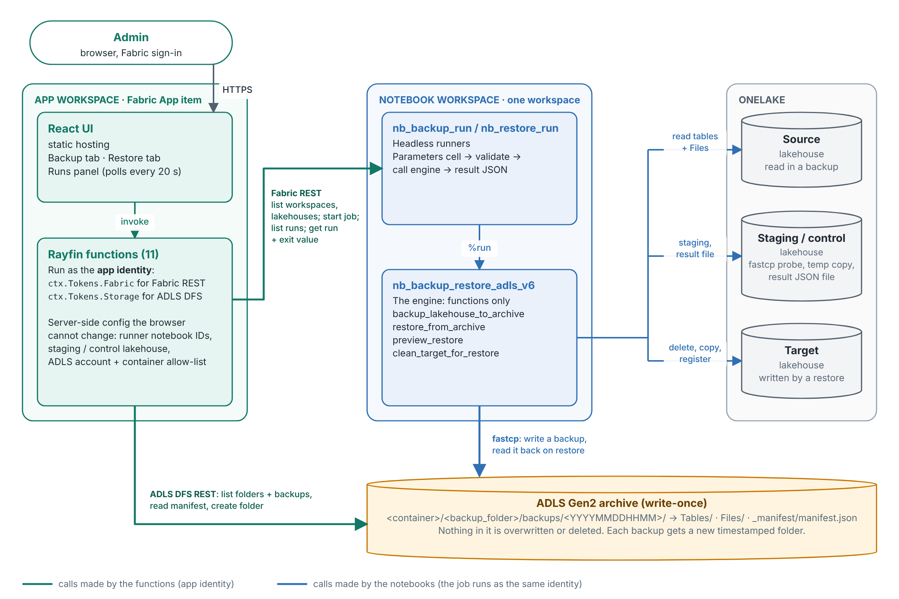

# Fabric Lakehouse Backup Admin

A Microsoft Fabric App for backing up a whole Lakehouse to your own ADLS Gen2 storage and restoring it later, from a screen instead of a notebook.

It's built with Rayfin 2.0: a React UI, plus server functions that start Fabric notebooks with the Run On Demand Notebook Job API. It copies a Lakehouse's Delta tables and its Files area to an ADLS Gen2 container. Each backup goes into a new timestamped folder with a manifest, and nothing in the archive is overwritten or deleted. You can restore everything, selected schemas or selected tables into a Lakehouse, with an optional read-only preview first.

- It runs in your own tenant. It isn't a shared service.
- Storage access uses Azure RBAC on the app's identity, so there are no keys or SAS tokens.
- Only the admins you list can back up or restore. A Fabric Free licence is enough for other users to open the app when its workspace has capacity.

MIT licensed; see [LICENSE](LICENSE). Test it in a non-production workspace first.

## Quick start

You'll need a Fabric capacity, the Fabric Apps tenant setting turned on, an ADLS Gen2 account with hierarchical namespace, a notebook workspace and a staging Lakehouse, and Node.js 22.13 or later.

```sh
git clone https://github.com/vensyd0503/fabric-lakehouse-backup-admin.git && cd fabric-lakehouse-backup-admin
npm ci
npm run setup              # writes rayfin/.env, rayfin/.env.secrets and packages/functions/local.settings.json
npm run setup:notebooks    # imports the 3 notebooks by name (az login to the tenant, or FABRIC_ACCESS_TOKEN)
npx rayfin login -t <tenant-id>
npx rayfin up -n --workspace-id <APP_WORKSPACE_ID> --item-name backup-admin   # dry run, check the target
npx rayfin up --workspace-id <APP_WORKSPACE_ID> --item-name backup-admin
npx rayfin secret set --env-file rayfin/.env.secrets
npx rayfin --json secret list   # all seven names should appear
npx rayfin up --workspace-id <APP_WORKSPACE_ID> --item-name backup-admin      # redeploy so dynamic claims and the secrets-typed build are live
```

Open the app from the Fabric portal. You can also open the hosting URL. Hosted assets are protected, so the app content stays behind sign-in.

See the [full install guide](#full-install) below for permissions, the seven settings and who owns the app.

## Full install

The staging Lakehouse must already exist. `npm run setup` does not create it and does not call Fabric. `npm run setup:notebooks` does call Fabric: it imports `nb_backup_restore_adls_v6`, `nb_backup_run` and `nb_restore_run` into `NOTEBOOK_WORKSPACE_ID`. The item names have to stay exactly like that. The runners `%run` the engine, and the app finds the runners by display name.



More diagrams: [a backup](docs/diagrams/02-backup-flow.png), [a restore](docs/diagrams/03-restore-flow.png), [the notebooks](docs/diagrams/04-notebook-internals.png), [the archive layout](docs/diagrams/05-archive-layout.png), [the install flow](docs/diagrams/install-flow.png).

### Restore scope

A backup writes `backups/<YYYYMMDDHHMM>/_manifest/manifest.json`. The engine will not reuse that folder. Restore reads a complete manifest only.

- **Full restore** sets `clean_target` to `all`. It deletes every table in the target. When the backup copied Files, the app also sets `restore_files`, which clears Files and restores them. If the backup has no Files, the target's Files are left alone.
- **Selected schemas** and **selected tables** set `clean_target` to `replace`. They delete and replace only the tables you picked. They do not touch Files.
- Both cleanup options ask you to type the target Lakehouse name. It must match the resolved name exactly, including case.
- Preview is optional. It runs with `mode` `preview` and `dry_run` true, and it does not change the target. Restore works without a preview.
- The staging Lakehouse cannot be a restore target.

Leave the backup table filter empty to copy every table. A comma-separated list limits the backup to those tables. Files are still copied: the app does not send `copy_files`, so the notebook default (`true`) applies.

### Permissions

The functions and the notebook jobs run as the app identity, which is the owner of the Fabric app item: the identity that creates the item with `rayfin up`. Grant that identity:

- **Storage Blob Data Contributor** on the ADLS Gen2 storage account, at storage-account scope, not container scope. The app creates folders, so a role that only lists them is not enough.
- **Contributor** on the notebook workspace (so it can run the notebooks) and on each source workspace and each target workspace. Contributor is the level described as known to work. Narrower Fabric roles were not tested.

The installer needs Contributor on the notebook workspace to import the notebooks, and Azure CLI signed in to that tenant (`az login`), unless `FABRIC_ACCESS_TOKEN` is set. Other people you share the app with do not need rights on the Lakehouses. They call the app, and the app calls Fabric and storage as the app identity. Only subjects in `ADMIN_SUBJECTS` can back up, restore, or create archive folders. Everyone else can browse backups and view runs.

```sh
az role assignment create --assignee <app-owner-object-id> --role "Storage Blob Data Contributor" --scope /subscriptions/<subscription-id>/resourceGroups/<resource-group>/providers/Microsoft.Storage/storageAccounts/<storage-account>
```

When that role is missing, browsing the archive folder shows "Can't reach the app's functions. Check you're online and try again." instead of a storage error.

### The seven settings

`npm run setup` writes these to `rayfin/.env.secrets`. `npx rayfin secret set --env-file rayfin/.env.secrets` uploads them after the first deploy. The names are declared under `secrets:` in `rayfin/rayfin.yml`.

| Secret | What it is |
| --- | --- |
| `NOTEBOOK_WORKSPACE_ID` | Workspace that holds the three notebooks. |
| `STAGING_WORKSPACE_ID` | Workspace of the staging Lakehouse. |
| `STAGING_LAKEHOUSE_ID` | Staging Lakehouse. Not a backup source or a restore target. Used for probes and run result files. |
| `ADLS_ACCOUNT` | ADLS Gen2 storage account name. 3 to 24 lowercase letters or digits. |
| `ADLS_CONTAINER` | Container that holds the archive. |
| `ADLS_ARCHIVE_FOLDER` | Prefix inside the container. A single hyphen means the container root, so the value is never empty. |
| `ADMIN_SUBJECTS` | Comma, semicolon, or whitespace separated admin UPNs or Entra object IDs. Include each admin's Entra object ID. Dynamic claims may only give the function the object ID. |

Examples with placeholders are in `rayfin/.env.secrets.example`. Do not commit `rayfin/.env.secrets`.

### Who owns the app

Whoever runs `rayfin up` and creates the Fabric app item is the item owner, and that owner is the app identity. Notebook jobs started by the functions run as that same identity, not as the person who clicked Backup or Restore. Give the storage role and the workspace Contributor roles to that identity before you rely on a backup.

`rayfin.yml` sets the item id to `backup-admin`, which is why the deploy commands pass `--item-name backup-admin`. `--workspace-id` is the workspace that will host the app. `-n` is a dry run: it checks the target and does not deploy. Run `rayfin up` again after `secret set` so dynamic claims and the secrets-typed build are live.

A longer install draft, including items still marked unverified, is in [docs/INSTALL.md](docs/INSTALL.md). The publish commands are also in [INSTALLATION_STEPS.md](INSTALLATION_STEPS.md). Notebook parameters and guards are in [notebooks/README.md](notebooks/README.md).

## Developer reference

### Workspace layout

```text
.
├── package.json                 # Root commands and the applied functions pack
├── rayfin/
│   └── rayfin.yml               # Fabric services, protected hosting, secret names
├── notebooks/                   # Engine, two headless runners, and optional interactive notebooks
├── packages/
│   ├── frontend/                # React and Vite UI (@rayfin-app/frontend)
│   ├── functions/               # Server functions (@rayfin-app/functions)
│   ├── data/                    # Data package; the data service is disabled
│   └── shared/                  # Isomorphic contracts (@rayfin-app/shared)
└── scripts/                     # Setup, notebook import, and checks
```

Run commands from the workspace root. `rayfin/rayfin.yml` enables functions (`packages/functions`, application auth), Fabric auth, dynamic claims, and static hosting. Password auth is off. `assetAccess` is `protected`. The data and storage services are off.

### Root commands

| Command | What it does |
| --- | --- |
| `npm run dev` | Starts Rayfin local services and the frontend. |
| `npm run dev:frontend` | Starts only the frontend dev server. |
| `npm run build` | Builds shared, validates and builds functions, then builds data and the frontend. |
| `npm run build:fabric` | Same as build, with the frontend Fabric packaging build. |
| `npm run typecheck` | Builds shared and functions, then type-checks the workspace and `scripts/`. |
| `npm run lint` | Lints the frontend. |
| `npm test` | Runs the frontend tests and the setup and functions script tests. |
| `npm run preview` | Previews the built frontend. |
| `npm run setup` | Writes the env files and local function settings. Does not call Fabric. |
| `npm run setup:notebooks` | Imports the three notebooks with the installer's Fabric token. |
| `npm run rayfin:up` | Runs `rayfin up`. |
| `npm run pack:add -- <pack>` | Applies a capability pack. Functions is already applied. |

`npm run dev` uses the signed-in developer's tokens. A call that works locally can fail after deploy until the app identity has the roles above.

## License

MIT. See [LICENSE](LICENSE).
