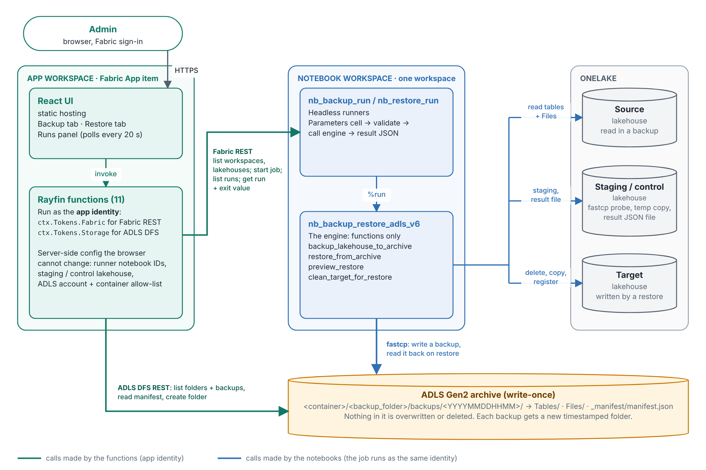
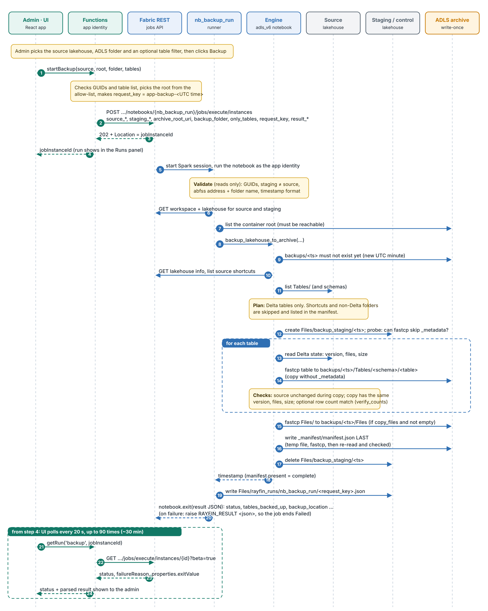
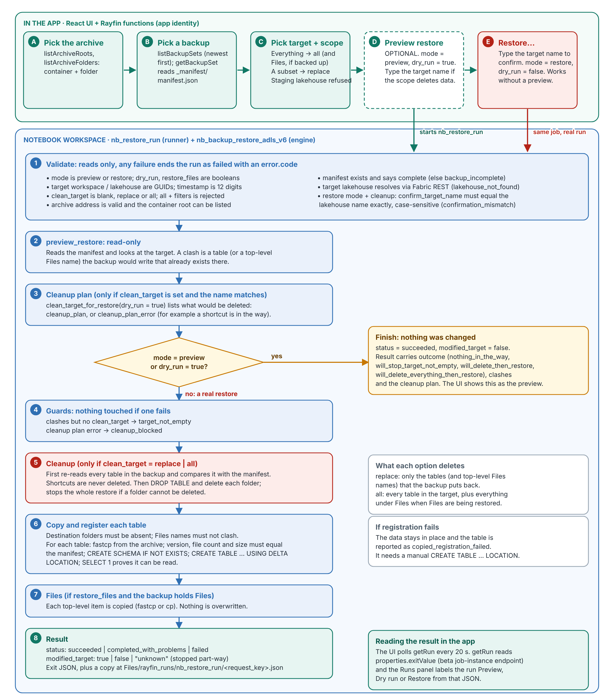
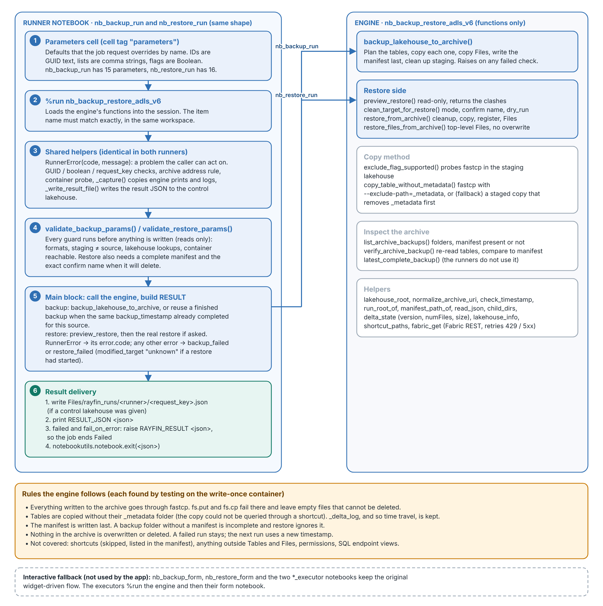
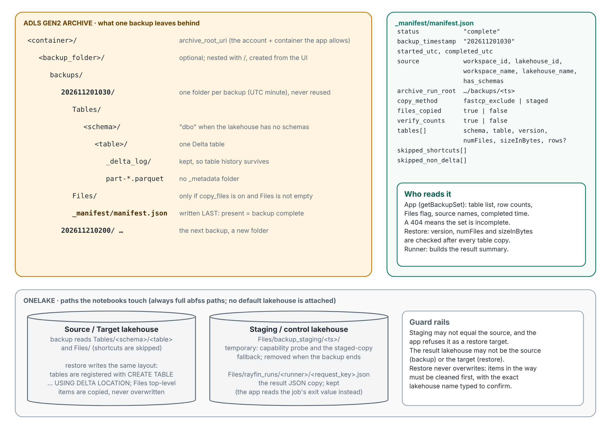
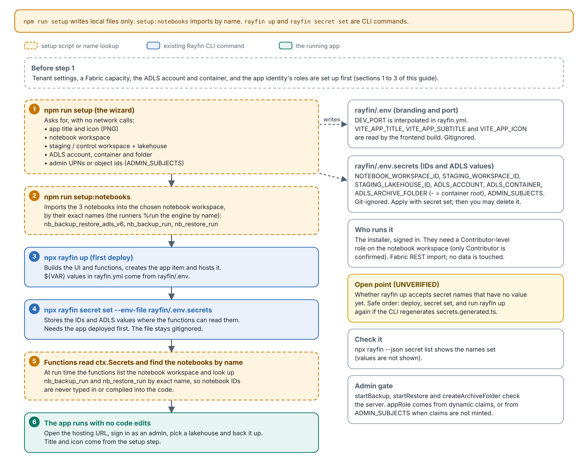

# Lakehouse Backup & Restore Admin — Install Guide (DRAFT)

The commands that publish the app are in [INSTALLATION_STEPS.md](../INSTALLATION_STEPS.md).

> **Status: draft for review.** This is the install path for a config-driven build. `npm run setup`,
> `npm run setup:notebooks`, the secret-backed deployment config and the server-side admin gate are in
> the repo. Items tagged **[KB]** are confirmed by the Rayfin/Fabric Apps knowledge base (path given).
> Items tagged **[NB]** are confirmed by the notebook README/code. Items tagged **UNVERIFIED** are
> guesses or could not be confirmed — test them before you rely on them. Phase 2 (runtime settings in
> the app database) is still not built.
> KB root: `/home/box/agent-data/kb/fabric-rayfin/` (cited as `rayfin-docs/…`, `learn/…`).
> Nothing in this guide has been run against any tenant.

## 0. What you are installing

A Rayfin 2.0 **Fabric App** (React UI + server functions) that drives three **Fabric notebooks** to back up a
Lakehouse to **ADLS Gen2** and restore from it.

### How it fits together



*Source: [SVG](diagrams/01-architecture.svg). The functions call Fabric REST and the ADLS DFS endpoint with the app
identity's tokens (`ctx.Tokens.Fabric`, `ctx.Tokens.Storage`). The notebook jobs they start run as that same
identity, so ADLS access is plain Azure RBAC on it [NB README "Identity and permissions"].*

### A backup, end to end



*Source: [SVG](diagrams/02-backup-flow.svg). The staging lakehouse is only used for a short fastcp capability probe
and as a fallback stop for the copy. In the normal path each table goes straight from the source to the archive.*

### A restore, end to end



*Source: [SVG](diagrams/03-restore-flow.svg). Preview is optional: the Restore button works without one. The
"Everything" scope always uses `clean_target = all`, so it empties the target before it restores.*

### How the notebooks work inside



*Source: [SVG](diagrams/04-notebook-internals.svg).*

### What a backup looks like



*Source: [SVG](diagrams/05-archive-layout.svg). All diagrams are generated by the scripts in
[`diagrams/src`](diagrams/src); see [`diagrams/README.md`](diagrams/README.md).*

- **No Fabric connection / linked service / key / SAS is used for ADLS.** The engine reads and writes the
  archive with the running identity's own Azure RBAC ("storage pass-through") [NB README "Unverified" para;
  engine code has no connection or credential handling]. So ADLS access = Azure RBAC on the identity above.
- **Each adopter runs their own instance** in their own tenant. This is not a multi-tenant service.
- The archive is write-once: nothing in it is overwritten or deleted; each backup goes to a new
  `backups/<YYYYMMDDHHMM>` [NB README, engine].

## 1. Prerequisites

### 1.1 Fabric capacity and licensing
| Need | Detail | Source |
|---|---|---|
| Fabric capacity on **every** workspace that runs Spark | Fabric **F SKU**, active **Fabric trial**, or Power BI **Premium P** with Fabric enabled. Pro/PPU alone does not provide capacity. | `learn/pages/licensing.md` ("Supported capacity…"), `learn/pages/pricing.md` |
| App workspace has capacity | App services consume CUs from the workspace's capacity. No Rayfin-specific meter. | `rayfin-docs/pages/deploy/pricing.md`, `learn/pages/overview.md#license-and-workspace` |
| Notebook workspace has capacity | The notebooks use Spark; "trial or F SKU". | [NB] README "Import — workspace and order" step 1 |
| End users | A Fabric (Free) licence is enough to use the app item when its workspace has capacity. | `learn/pages/licensing.md` |
| Smallest workable F SKU | Not stated anywhere. **UNVERIFIED** — pilot on a small F SKU (F2/F4 is a guess) with your largest lakehouse before committing. |
| Region | Functions and dynamic claims are not available in every region/tenant. Check [Fabric region availability] first, then prove it with a minimal deploy. | `rayfin-docs/pages/reference/known-limitations.md` (service availability), `learn/pages/overview.md#regions-supported` |

### 1.2 Tenant settings (Fabric admin portal → Tenant settings; a **Fabric tenant admin** must do these)
| Setting | Needed for | Source |
|---|---|---|
| **Fabric Apps** (a.k.a. "Fabric Apps (preview)") = Enabled, for the whole org or a security group | Creating the app item at all | `learn/pages/overview.md#tenant-admin-settings`, `rayfin-docs/pages/deploy/fabric-apps.md#tenant-setting` |
| Setting that **allows service principals to use Fabric APIs** | Only if you deploy with a service principal (CI, or a dedicated install identity). Exact setting name not in KB. | `learn/pages/deploy-github-actions.md` (IMPORTANT note after Step 1) — **name UNVERIFIED** |
| *Not needed unless you add Phase 2:* **Users can access data stored in OneLake with apps external to Fabric** (on by default) | Rayfin **Storage** (icon upload, runtime settings) — **[PROPOSED] Phase 2 only** | `learn/pages/storage.md#prerequisites` |
| *Not needed:* anonymous data access | This app never uses `@anonymous`; keep it off | `rayfin-docs/pages/data/permissions.md` |
| Settings that let users create/run **notebooks / Spark / Lakehouses** | Notebook workspace | Not in KB — **UNVERIFIED**. Standard Fabric tenant settings; confirm with your Fabric admin. |
| Strict CSP setting for static-hosted apps (optional, preview) | Only if your org turns it on | `learn/pages/content-security-policy.md` — compatibility with this UI not tested, **UNVERIFIED** |

### 1.3 Workstation
| Tool | Version | Source |
|---|---|---|
| Node.js | **24 recommended**. Rayfin CLI declares 20, 22, 24; the Universal App template needs **≥ 22.13** (this project's `package.json` engines is `>=22.13.0`). | `rayfin-docs/pages/start/installation.md` |
| npm | bundled with Node | same |
| TypeScript | 6.0.x per this project (`~6.0.2`); Rayfin supports 5.7.2+ 5.x or 6.0.2+ 6.x | same; project `package.json` |
| Rayfin CLI | `@microsoft/rayfin-cli` **^2.0.1** (project dev dependency). Run as `npx rayfin` so it matches installed packages. Keep **all** `@microsoft/rayfin-*` and `@microsoft/fabric-user-data-functions` at the same version. | `rayfin-docs/pages/reference/agent-rules.md#versions`, `rayfin-docs/pages/functions/deploying.md` |
| OS keychain | If missing (containers/Codespaces) use `--encryption-fallback-enabled` (plaintext tokens; dev only) | `rayfin-docs/pages/reference/cli/login.md` |

### 1.4 Azure
- An **Azure subscription** and permission to create a **storage account with hierarchical namespace
  (ADLS Gen2)** and to assign Azure RBAC roles on it (Azure standard; not in the KB). The archive address
  format the engine accepts is exactly `abfss://<container>@<account>.dfs.core.windows.net[/<folder>]`
  [NB engine code, parameters cell].
- Storage network rules: if the account uses a firewall / private endpoints, Fabric Spark and the Rayfin
  function host must be able to reach it. **UNVERIFIED** — start with public network access enabled
  (restricted by RBAC) and tighten after the smoke test passes.

### 1.5 People
- **Installer**: a person (or a dedicated install identity) with the access in the matrix (section 3).
- **Fabric tenant admin** (one-off: tenant settings).
- **Azure RBAC admin** on the storage account (one-off: role assignments).
- 1+ **app admins** (who may restore and change settings).

## 2. Artefacts to create — in this order

Tick each off before the first deploy. IDs you collect here feed section 4.

### A1. Decide the identity story (before creating anything)
The app's server code calls Fabric and ADLS as the **app identity = the owner of the Fabric app item**
(`rayfin-docs/pages/reference/known-limitations.md#function-connections-run-only-as-the-app-identity`;
`learn/pages/functions-connect-external-resources.md#grant-resource-permissions`). In practice that is whoever
creates the item with `rayfin up`. The notebooks then run as that same identity [NB].

- **Recommended:** create the app item from a dedicated, long-lived identity rather than a person who may leave.
  Service-principal sign-in for `rayfin up` is documented (`rayfin-docs/pages/reference/cli/login.md`,
  `learn/pages/deploy-github-actions.md`).
- **UNVERIFIED:** whether a service principal that creates the item becomes the "owner"/app identity, and whether
  that identity can run Spark notebooks with ADLS pass-through. The notebook README says to **test this first
  with the real app identity** [NB README]. Public Fabric docs say the Run On Demand Notebook and Create
  Notebook APIs support service principals (learn.microsoft.com, not KB) — that is API-level only.
- Write down the identity you will use: `APP_IDENTITY = ______` (UPN or SP name). Every "app identity" grant in
  section 3 goes to it.

### A2. Entra groups (all optional, but recommended)
| Group | Purpose | Source / status |
|---|---|---|
| `fabric-apps-pilot` | Scope the **Fabric Apps** tenant setting to a pilot group instead of the whole org | `learn/pages/overview.md#tenant-admin-settings` ("specific security groups") [KB] |
| `backup-app-users` | People you share the app item with (Run and interact) | Sharing "people" is documented (`learn/pages/share-app.md`); whether you can share to a security group is **UNVERIFIED** in the KB |
| `backup-app-admins` | Human-readable record of who is admin | The admin gate reads the `ADMIN_SUBJECTS` secret (UPNs or Entra object ids), not group membership. The claims function runs before any token exists and has no Graph access (`rayfin-docs/pages/auth/dynamic-claims.md#what-the-function-can-use`). Group-based admin would need an external lookup — **UNVERIFIED / not designed**. |

### A3. ADLS Gen2 storage account, container and archive layout
1. Create a storage account with **hierarchical namespace enabled** (StorageV2/ADLS Gen2). Region: same as the
   Fabric capacity is sensible for cost/latency — **UNVERIFIED**, not required by the KB.
2. Create one **container**, e.g. `lakehouse-backups`.
3. Folder layout is produced by the notebooks; you only choose an optional prefix per team/environment
   (the app's "backup folder" picker and "New folder" button create prefixes) [function code `createArchiveFolder`, NB README `backup_folder`]:
   ```
   <container>/
     [<prefix>/]                       ← optional "backup_folder" (letters, digits . _ -, "/" to nest, max 10 levels)
       backups/
         <YYYYMMDDHHMM>/              ← one folder per backup (UTC), never overwritten
           _manifest/manifest.json    ← status, completed_utc, source names, table list, row counts
           <schema>/<table>/…         ← Delta tables
           Files/…                    ← optional copy of the Files area
   ```
   The restore UI lists only 12-digit folders under `backups/` and treats a backup as restorable only when
   `manifest.json` says `complete` [function code `listBackupSets`/`getBackupSet`, NB README].
4. Optional hardening (soft delete, immutability, lifecycle) — **UNVERIFIED** with the engine's `fastcp` writes; test first.
5. Record: `ADLS_ACCOUNT`, `ADLS_CONTAINER`. Role assignments come in A9.

### A4. The notebook's ADLS access (the "connection")
There is **nothing to create** in Fabric (no connection, no linked service, no key vault, no SAS).
The notebooks use the calling identity's RBAC on the container [NB]. Verify by running the runner once with
the real app identity (smoke test, section 6). If pass-through fails for a service principal/managed identity,
the fallback is a design change (not in this draft) — see UNVERIFIED #3.

### A5. Notebook workspace
1. Create (or choose) **one** Fabric workspace on capacity. **All** notebooks must be in the same workspace
   because the runners `%run` the engine and `%run` only works within one workspace
   [NB README import step 3, citing Learn "Reference run"].
2. Grant `APP_IDENTITY` **Contributor** on it (A9).
3. Record `NOTEBOOK_WORKSPACE_ID`.
4. Spark runtime/environment: not pinned by the repo. **UNVERIFIED** — the engine uses Delta (`DeltaTable`),
   `fastcp` and `notebookutils`; confirm on your workspace's default runtime and pin it if needed.

### A6. Import the notebooks (exact names matter)
Import into the A5 workspace, **item names exactly as below** (the runners do `%run nb_backup_restore_adls_v6`) [NB README]:
| Notebook | Required | Role |
|---|---|---|
| `nb_backup_restore_adls_v6` | yes | Engine (import first) |
| `nb_backup_run` | yes | Headless backup runner |
| `nb_restore_run` | yes | Headless restore runner |
| `nb_backup_form`, `nb_restore_form`, `nb_backup_executor`, `nb_restore_executor` | optional | Interactive fallback |

Rules:
- **Do not attach a default lakehouse** to any of them [NB README step 4].
- Do not edit the parameters cell defaults; the app overrides them per run. Parameter names are
  case-sensitive and must match the code cell. Types: `Text`, `Boolean` [NB README "Parameters and types"].
- `npm run setup:notebooks` imports the three required notebooks by exact display name. It uses the
  installer's Fabric token (`FABRIC_ACCESS_TOKEN`, or `az account get-access-token --resource https://api.fabric.microsoft.com`).
  Before it calls Fabric it prints the account and tenant from the token (`upn` and `tid`; no extra network call).
  If Azure CLI is signed into another tenant, pass the workspace tenant: `npm run setup:notebooks -- --tenant <id-or-domain>`
  (that becomes `az account get-access-token --tenant`). A 401 or 403 tells you to run
  `az login --tenant <tenant> --allow-no-subscriptions`.
  It posts the Fabric Create Notebook / Update Notebook Definition shape (`format: ipynb`, part
  `notebook-content.ipynb`). That call has **not** been executed against a tenant — **UNVERIFIED**
  (Contributor, `Notebook.ReadWrite.All` or `Item.ReadWrite.All`, and whether update overwrites). Manual
  import in the Fabric UI works the same, as long as the names stay exact.
- At run time the functions list `GET /v1/workspaces/{NOTEBOOK_WORKSPACE_ID}/items?type=Notebook` and take
  `nb_backup_run` and `nb_restore_run` by `displayName`. Whether the **app identity** token can make that
  call is **UNVERIFIED**. Notebook ids are not configuration.

Parameters the app sends (for reference; you never set these by hand) [NB README + function code]:
| Notebook | Parameters |
|---|---|
| `nb_backup_run` | `source_workspace_id`, `source_lakehouse_id`, `staging_workspace_id`, `staging_lakehouse_id`, `archive_root_uri`, `backup_folder`, `only_tables`, `request_key`, `result_workspace_id`, `result_lakehouse_id` (+ defaults: `copy_files`, `verify_counts`, `fail_on_error`) |
| `nb_restore_run` | `mode` (`preview`\|`restore`), `archive_root_uri`, `backup_folder`, `backup_timestamp`, `target_workspace_id`, `target_lakehouse_id`, `restore_files`, `only_schemas`, `only_tables`, `clean_target` (`""`\|`replace`\|`all`), `confirm_target_name`, `dry_run`, `request_key`, `result_workspace_id`, `result_lakehouse_id` |

### A7. Staging / control lakehouse
- One lakehouse, **not** a backup source or restore target. Used for `Files/backup_staging/<ts>` during backups and
  for result files `Files/rayfin_runs/…` [NB README "Identity and permissions", "How results come back"].
- Easiest: create it **in the notebook workspace** (e.g. `lh_backup_staging`) so the same Contributor grant covers it.
- The app refuses to use it as a restore target [function code]. Record `STAGING_WORKSPACE_ID`, `STAGING_LAKEHOUSE_ID`.
- `npm run setup` asks for those two ids. It does **not** create the lakehouse. Create it in Fabric first.

### A8. Fabric App workspace and the App item
1. Pick (or create) the app workspace on capacity. It can be the notebook workspace or a separate one — **UNVERIFIED** which is better; separate is cleaner for access control.
2. The **Fabric App item** is created by the first `rayfin up` (section 5). Item name defaults to `id` in
   `rayfin.yml`; override with `--item-name` [KB `rayfin-docs/pages/deploy/rayfin-up.md#target-a-workspace-or-item`].
3. Capacity: if the workspace has none, `rayfin up` can prepare/assign it (`--capacity-id`), subject to tenant rules
   [KB `rayfin-docs/pages/deploy/pricing.md#capacity-readiness-and-trials`]. **Do not** combine `--capacity-id` with a workspace selector.
4. Record `APP_WORKSPACE_ID` (GUID) and `APP_ITEM_NAME`.

### A9. Permissions (do these before deploy; matrix in section 3)
In this order: (a) tenant settings; (b) workspace roles for `APP_IDENTITY` on notebook, staging, source and target
workspaces; (c) Azure RBAC on the container for `APP_IDENTITY`; (d) installer roles; (e) later, after deploy:
share the app to users.

### A10. Hosting
- Static hosting is created by `rayfin up` from `services.staticHosting` in `rayfin.yml`; you get a hosting URL.
  Keep `assetAccess: protected` (Fabric sign-in required) and `embedded.only: false` [KB `rayfin-docs/pages/hosting.md`, `reference/agent-rules.md#security`].
- **Redirect URIs:** `rayfin.yml` keeps `http://localhost:${DEV_PORT:-5173}` and `http://127.0.0.1:${DEV_PORT:-5173}`.
  `rayfin up` registers the hosted origin itself; "You do not need to add the hosted origin before the first deploy"
  [KB `rayfin-docs/pages/hosting/redirect-uris.md`]. `DEV_PORT` comes from `rayfin/.env` (default 5173).
- Sign-in is Fabric SSO only on deployed apps [KB `learn/pages/deploy-app.md#configure-authentication`].

### A11. Admin gate
Two roles. **Admin** may call `startBackup`, `startRestore` (preview and restore) and `createArchiveFolder`.
**User** may browse backups and view runs. The UI hides those actions when `getMyRole` does not return
`admin`. The server check is what counts.

- `services.auth.dynamicClaims.enabled: true`. One inline `udf.authClaims` returns `{ appRole: string }`
  (`admin` or `user`) by comparing `ctx.auth.userId` and `ctx.auth.email` with the `ADMIN_SUBJECTS` secret
  (`ctx.getSecret`, which is the claims-function API). `role` is a reserved claim name.
  [KB `rayfin-docs/pages/auth/dynamic-claims.md`]
- A missing or empty admin list mints `user` for everyone. Sign-in is not denied. Nobody is admin until the
  secret is set.
- Region-gated: where dynamic claims are off, sign-in still works and the provider is not called
  [KB `known-limitations.md#dynamic-auth-claims-depend-on-the-workspaces-region`]. Mutating functions then
  compare `ADMIN_SUBJECTS` with `ctx.user.id`. That value is the subject id, not an email
  [KB `functions/writing-functions.md`]. Put **Entra object ids** in `ADMIN_SUBJECTS` if this region might
  not mint claims. UPNs are matched when the claims function runs. Whether a regular function can still read
  the base `email` claim when `ctx.getClaims()` throws is **UNVERIFIED** — the documented `ctx.user` object
  has no email, and `getClaims()` throws when a required custom claim is missing.
- Confirm after deploy: sign in as an admin and as a user. `getMyRole` should report `source: "claims"` when
  the region mints claims, and `source: "subjects"` when it does not.

## 3. Permissions matrix

Legend: ✔ required · ◐ optional/conditional · — not needed · **UNVERIFIED** = guess or minimum not tested.
"Contributor" is the safe level the README says is known to work; narrower roles are untested.

| Principal | Notebook workspace (+ staging lakehouse) | Source workspace/lakehouse (backups) | Target workspace/lakehouse (restores) | App workspace / app item | ADLS (Azure RBAC on container) | Entra / API / tenant |
|---|---|---|---|---|---|---|
| **Installer** (person or install identity) | **Contributor+** to import notebooks and create the staging lakehouse (Create Notebook doc: "contributor workspace role" — not KB). Also needed to grant roles: **Admin** if they assign the app identity's role. | — (only to *look*, for smoke test) | — | **Contributor or Admin** on the workspace to run `rayfin up`; item permission **Edit** to deploy/update settings; **Admin** to assign capacity or reshare. `deploy/fabric-apps.md#permissions`, `learn/pages/overview.md#item-permissions` | Azure rights to create the account and assign roles (Owner / User Access Administrator / RBAC Administrator on the account) — Azure standard, not KB | Entra sign-in in the target tenant (`rayfin login -t <tenant>`); membership of the tenant-setting group if scoped; rights to create Entra groups (A2). A **Fabric tenant admin** must do §1.2 once. |
| **App identity** = owner of the app item (`known-limitations.md#function-connections-run-only-as-the-app-identity`). Also the identity the notebooks run as [NB] | ✔ **Contributor** (run notebooks; README: scope `Notebook.Execute.All`/`Item.Execute.All` + role "Contributor is the safe choice"). Staging lakehouse: **write** (creates/removes `Files/backup_staging/<ts>`, writes `Files/rayfin_runs/…`). Minimum role **UNVERIFIED**. | ✔ **read** tables + Files and **list shortcuts**; Contributor known to work, narrower **UNVERIFIED** [NB README] | ✔ **write + delete** tables/Files, `CREATE SCHEMA`, `CREATE TABLE … LOCATION` [NB README] — Contributor | Owns the item (it *is* the owner). No extra role stated. Also the workspaces list the app shows in its pickers is whatever this identity can see — **expected Fabric REST behaviour, UNVERIFIED in KB**. | ✔ **Storage Blob Data Contributor** on the container: backups write via `fastcp`; app also creates archive folders. Restore/preview alone need only Reader [NB README; `functions/connections.md` "Call Azure Blob Storage"]. Storage data roles are required — Owner/Contributor management roles are not enough (Azure standard). | Function tokens: `ctx.Tokens.Fabric` (Fabric REST) and `ctx.Tokens.Storage` (ADLS DFS) [KB `functions/connections.md`]. Fabric API scope list for these tokens is **not in the KB — UNVERIFIED**. If an SP: tenant setting allowing SPs to use Fabric APIs (**name UNVERIFIED**). Declaring audiences does **not** grant permissions [KB `learn/pages/functions-connect-external-resources.md`]. |
| **App users** (Fabric Free licence is enough) | — (no grant needed: application authentication, users don't need source grants) `learn/pages/share-app.md#how-authentication-affects-sharing` | — | — | App item: **Run and interact** (Read + execute). Workspace Viewer + item Run and interact opens the app. `deploy/fabric-apps.md#permissions`, `learn/pages/overview.md#item-permissions` | — | Sign in via Fabric SSO. `appRole=user`: browse backups and view runs. Backup, restore and new folders are refused. |
| **App admins** | — | — | — | Same as users. **Edit** on the app item only if they will redeploy/change secrets; **Reshare** needs workspace **Admin**. `learn/pages/overview.md#item-permissions` | — | `appRole=admin` when their UPN or object id is in `ADMIN_SUBJECTS`. Only admins may back up, restore (including preview) and create archive folders. |

Notes
1. **Why users need nothing on the data:** the functions call Fabric/ADLS as the app identity, not the caller. The
   flip side is that app access plus no admin gate equals the app identity's full power — hence A11.
2. **Source/target workspaces:** grant the app identity Contributor on each workspace whose lakehouses should be
   backed up or restored. Adding a new team = granting that role + nothing else.
3. **Local `rayfin dev` uses the developer's own tokens, not the app identity** — a call that works locally can
   fail after `rayfin up` (`known-limitations.md#local-function-connections-use-your-own-identity`). Always
   smoke-test the deployed app.
4. Setting/listing/deleting secrets needs the signed-in account to have access to the target workspace and app item
   (`rayfin-docs/pages/deploy/secrets.md`, "Permission denied"). Who can *read* secret values beyond the app's
   own functions is not documented — **UNVERIFIED**; treat anyone with Edit on the app item as able to change them.

## 4. Configuration reference

`npm run setup` writes `rayfin/.env` and `rayfin/.env.secrets`. Examples with placeholders are committed as
`rayfin/.env.example` and `rayfin/.env.secrets.example`. There is no `app.config.json` and no `ARCHIVE_ROOTS_JSON`.

| Key | Example | Where | Read by | Notes |
|---|---|---|---|---|
| `DEV_PORT` | `5173` | `rayfin/.env` | `rayfin.yml` `${DEV_PORT:-5173}` in `allowedRedirectUris` | Default 5173 when unset [KB `reference/config/env-interpolation.md`] |
| `VITE_APP_TITLE` | `Contoso Backup` | `rayfin/.env` | frontend build (`<title>` and the header) | Default `Lakehouse Backup & Restore` |
| `VITE_APP_SUBTITLE` | `Lakehouse archive for Contoso` | `rayfin/.env` | frontend build (header subtitle) | Default describes a lakehouse-to-ADLS archive |
| `VITE_APP_ICON` | `app-icon.png` | `rayfin/.env` | frontend build | Setup copies your PNG to `packages/frontend/public/app-icon.png` and `favicon.png`. The served name stays `app-icon.png` |
| Icon source path | `/path/to/icon.png` | setup prompt or answers file `iconPath` | `npm run setup` only | Not a secret. Blank keeps the built-in icon |
| Tenant ID | GUID | `rayfin login -t <id>` | CLI | [KB `reference/cli/login.md`] |
| App workspace | GUID | `rayfin up --workspace-id <id>` | CLI | One selector only [KB `deploy/environments.md`] |
| App item name | `backup-admin` | `rayfin up --item-name` | CLI | Defaults to `id` in `rayfin.yml` [KB `deploy/rayfin-up.md`] |
| Capacity ID | GUID | `rayfin up --capacity-id` | CLI | Only if the workspace has none. Not with a workspace flag |
| `NOTEBOOK_WORKSPACE_ID` | GUID | secret, `rayfin/.env.secrets` | `ctx.Secrets.NOTEBOOK_WORKSPACE_ID` | Workspace that holds the three notebooks |
| Notebook names | `nb_backup_run`, `nb_restore_run`, `nb_backup_restore_adls_v6` | code constants | Fabric list items, by display name | Not configuration. Fixed because the runners `%run` the engine by name |
| `STAGING_WORKSPACE_ID` | GUID | secret | `ctx.Secrets.STAGING_WORKSPACE_ID` | Workspace of the staging lakehouse you already created |
| `STAGING_LAKEHOUSE_ID` | GUID | secret | `ctx.Secrets.STAGING_LAKEHOUSE_ID` | Not a backup source or a restore target |
| `ADLS_ACCOUNT` | `mystorageaccount` | secret | `ctx.Secrets.ADLS_ACCOUNT` | 3–24 lowercase letters or digits |
| `ADLS_CONTAINER` | `lakehouse-backups` | secret | `ctx.Secrets.ADLS_CONTAINER` | One container. The browser does not pick a second account |
| `ADLS_ARCHIVE_FOLDER` | `finance/prod` or `-` | secret | `ctx.Secrets.ADLS_ARCHIVE_FOLDER` | Prefix inside the container. A single hyphen means the container root, so the value is never empty |
| `ADMIN_SUBJECTS` | `admin@contoso.example, 00000000-0000-0000-0000-000000000001` | secret | `ctx.getSecret` in `udf.authClaims`, and `ctx.Secrets.ADMIN_SUBJECTS` when claims are not minted | Comma, semicolon or whitespace separated. At least one subject. See A11 for UPN vs object id |
| Redirect URIs | `http://localhost:5173` | `rayfin.yml` | auth | Hosted origin is registered by `rayfin up`. Do not commit a tenant hosting URL |
| `assetAccess` | `protected` | `rayfin.yml` | static hosting | Keep |
| Local function values | same secret names | `packages/functions/local.settings.json` `Values` (gitignored) | `process.env` while `rayfin dev` runs functions | Setup writes this file too [KB `functions/secrets.md`] |

Why secrets for the ids: they are the documented per-deployment store functions can read
(`functions/secrets.md`). `rayfin.yml` `${VAR}` interpolation only changes yml values
(`reference/config/env-interpolation.md`). There is no documented yml key for the UI title, so the
frontend build reads `VITE_APP_*` from `rayfin/.env` directly. Secret changes can take a few minutes to
reach a deployed function (`functions/secrets.md#runtime-resolution-order`).

Non-interactive setup: `npm run setup -- --answers answers.json`, or `npm run setup -- --non-interactive`
with `SETUP_TITLE`, `SETUP_SUBTITLE`, `SETUP_ICON_PATH`, `DEV_PORT` and the secret names above in the
environment. A non-TTY run uses the environment when `--answers` is omitted. The answers file fields are
`title`, `subtitle`, `iconPath`, `notebookWorkspaceId`, `stagingWorkspaceId`, `stagingLakehouseId`,
`adlsAccount`, `adlsContainer`, `archiveFolder`, `adminSubjects`, `devPort`.

## 5. First deploy — step by step

Only `rayfin` commands confirmed in the KB are used. Run from the project root.

**The install path at a glance:**



*Source: [SVG](diagrams/install-flow.svg). The numbered steps below are the manual equivalent.*

**Pre-flight (read-only)**
1. `node --version` → v24.x (or ≥ 22.13).
2. `git clone <repo> && cd <repo> && npm ci`.
3. `npx rayfin --version`.
4. `npx rayfin login -t <tenant-id>` (add `--encryption-fallback-enabled` only if there is no OS keychain), then
   `npx rayfin login status`. CI/install identity: `npx rayfin login --service-principal --client-id <id> --client-secret <secret> --tenant <tenant-id>`
   (`reference/cli/login.md`).
5. Complete A1–A9 above (tenant settings, groups, ADLS, notebook workspace + notebooks, staging lakehouse, roles).

**Configure and verify locally**
6. `npm run setup` (or `npm run setup -- --answers answers.json`). The interactive run prints a summary and asks `Write these files? [Y/n]` before it writes anything. It warns if every admin subject is an email (add an Entra object id; the fallback cannot see emails when dynamic claims are not minted) and if the icon is over 200 KB or not square (it is also copied to the favicon). It writes `rayfin/.env`, `rayfin/.env.secrets` and `packages/functions/local.settings.json`, and copies an icon PNG if you gave one. It does not call Fabric or create the staging lakehouse. Then `npm run setup:notebooks` (this one does call Fabric, as the installer).
7. Gates (these npm scripts exist today in the project): `npm run validate:functions`, `npm run typecheck`,
   `npm run lint`, `npm test`, then `cd packages/frontend && npm run build:fabric`.
   (After changing a function signature: `cd packages/functions && npx tsc --build --force`.)

**Preview, then deploy**
8. **Preview (no changes):** `npx rayfin up -n --workspace-id <APP_WORKSPACE_ID> --item-name <APP_ITEM_NAME>`
   (`-n` = `--dry-run`; validates inputs and resolves the workspace; does not build, create items, deploy, or write
   `.deployments.json`/`.env`) — `reference/cli/up.md`, `deploy/rayfin-up.md#preview-without-deploying`.
   Check the printed target workspace is the one you intend.
9. **Deploy:** `npx rayfin up --workspace-id <APP_WORKSPACE_ID> --item-name <APP_ITEM_NAME> --json > /tmp/rayfin-up.json`
   (non-interactive; first deploy needs an explicit workspace target). Read the JSON: overall `status`, and `components`;
   `generate: []` is fine because this app declares no connectors (`universal-app-template/skills/app-deployment/SKILL.md`).
   **Do not pass `--force`.** Note the hosting URL and the Fabric portal link.
10. `npx rayfin up status` → exits 0 when the deployment is healthy (`reference/cli/up.md#up-status`).
11. **Secrets** (the CLI requires a deployment first): `npx rayfin secret set --env-file rayfin/.env.secrets`
    with `NOTEBOOK_WORKSPACE_ID`, `STAGING_WORKSPACE_ID`, `STAGING_LAKEHOUSE_ID`, `ADLS_ACCOUNT`, `ADLS_CONTAINER`,
    `ADLS_ARCHIVE_FOLDER` and `ADMIN_SUBJECTS`. Verify with `npx rayfin --json secret list` (`reference/cli/secret.md`).
    The file is gitignored; delete it after the values are stored if you want it gone from the machine.
    Whether `rayfin up` accepts secret names declared in `rayfin.yml` that have no value yet is **UNVERIFIED**; the
    safe order is deploy → `secret set` → (if the CLI regenerated `secrets.generated.ts`) `npx rayfin up` again.
12. Deploy again so dynamic claims and the secrets-typed build are live: repeat steps 8–10. Do this after `secret set` if the CLI changed `secrets.generated.ts`.
13. **Grant the app identity** its roles if not already done (A9/section 3). Then share the app item with users
    (Fabric → app → Share; `learn/pages/share-app.md`).

**Smoke test (use a small throw-away lakehouse; do this before any real data)**
1. Open the hosting URL (hard-refresh); sign in with an **admin** account. Wait a few seconds after any redeploy —
   functions restart and the UI briefly shows "can't reach the app's functions".
2. Lookups: the workspace and lakehouse pickers populate; the ADLS location lists; "New folder" works
   (proves Fabric + Storage tokens and the Contributor role).
3. Backup a tiny test lakehouse → run completes → a `backups/<ts>/_manifest/manifest.json` exists in the container
   (proves notebook run as app identity + ADLS write — UNVERIFIED items #2/#3 are resolved here).
4. Restore tab: pick that backup → **Preview** (read-only) → expect an outcome such as `nothing_in_the_way`.
5. Real restore into a *different* empty test lakehouse (with the typed-name confirm if cleanup is selected).
6. Sign in as a **non-admin**: Backup, Preview, Restore and New folder stay disabled, and a direct `startBackup`, `startRestore` or `createArchiveFolder` call is refused. `getMyRole` returns `user`. An admin sees `admin`.
7. Failure path: remove the app identity's ADLS role → a run should fail early with `container_unreachable` [NB error codes].
8. Check the notebook runs in Fabric (Monitor hub) and note capacity usage in the Fabric Capacity Metrics app
   (`rayfin-docs/pages/deploy/pricing.md#monitor-usage`).

**Known quirk:** the app reads each run's result through the *beta* Get Job Instance endpoint (`beta=true`) because
the release version has no output field [function code `getRun`; NB README "How results come back"]. Public docs
say the release API's beta parameter is due to be deprecated 1 Apr 2028 — **UNVERIFIED** replacement path; the
control-lakehouse result file (`Files/rayfin_runs/<runner>/<request_key>.json`) is the fallback source.

## 6. Upgrades and uninstall

### 6.1 Upgrade the app
1. Back up `rayfin/.env`, `rayfin/.env.secrets` and `packages/functions/local.settings.json` (they are not in git). The icon copies under `packages/frontend/public/` are only special if you replaced them.
2. `git pull` (or merge the new tag). Review the release notes — breaking changes to config keys must be listed there.
3. `npm ci`, then the gates (step 7 above).
4. `npx rayfin up -n --workspace-id <APP_WORKSPACE_ID>` → review → `npx rayfin up --workspace-id <APP_WORKSPACE_ID> --json > /tmp/rayfin-up.json`.
   The existing item is reused (`deploy/rayfin-up.md`). Static upload is skipped if nothing changed;
   `--force-static-deploy` overrides (`reference/cli/up.md`). Partial deploys: `npx rayfin up functions deploy`,
   `npx rayfin up staticapp deploy` (`deploy/rayfin-up.md#skip-specific-deployment-phases`).
5. Re-run the smoke test (steps 1–4 at minimum). Allow a few minutes for secret caches (`functions/secrets.md`).
6. **Notebooks:** if the release changes a notebook, re-import the three notebooks (same names; overwrite or
   delete-then-import) **before** step 4 so the function and notebook parameters match. Never leave a running job
   during an upgrade. `npm run setup:notebooks` imports the three notebooks again (update when the name
   already exists). Overwrite behaviour of the Create/Update Notebook APIs is **UNVERIFIED**.
7. **Rayfin SDK/CLI upgrade** (e.g. 2.0.x → 2.x): bump **every** `@microsoft/rayfin-*` package and
   `@microsoft/fabric-user-data-functions` to the *same exact* version, `npm install`, and follow the changelog's
   upgrade section (`rayfin-docs/pages/reference/changelog.md#upgrade-to-20` is the 1.x→2.0 model).
   Refresh managed agent files with `npx rayfin init ai-files status` / `install` if you use them (`reference/cli/ai-files.md`).
   Release notes for 2.0.1 and the 2.1 beta were not found — **UNVERIFIED**.
8. **Rollback:** redeploy the previous git tag with the same commands; notebooks too. Archive data is never modified by an upgrade.

### 6.2 Uninstall
There is **no `rayfin` uninstall/destroy command in the KB**. Do these manually:
1. Stop use: tell users; optionally have a Fabric admin block the app (`learn/pages/overview.md`, "Block and unblock Fabric apps").
2. **Keep the archive** unless the data must go: it lives in your ADLS account, not in Fabric. Nothing the app does deletes it.
3. In the Fabric portal, delete the **Fabric App item** (this removes hosting, functions, and secrets stored on the item).
   Exact portal steps/consequences are not in the KB — **UNVERIFIED**.
4. Delete (or keep) the three notebooks, the staging lakehouse, and the notebook workspace if dedicated.
   Delete result files `Files/rayfin_runs/` from the staging lakehouse if retention policy requires.
5. Remove role assignments: the app identity's Contributor on source/target/notebook/staging workspaces and its
   Storage Blob Data Contributor on the container; remove the Entra groups from A2.
6. If you used a dedicated install identity / service principal: rotate or delete its secret and remove it from
   the **allow service principals to use Fabric APIs** setting group.
7. Locally: `npx rayfin logout`; delete `rayfin/.env`, `rayfin/.deployments.json`, `local.settings.json`, the secrets dotenv.
8. If Phase 2 was used: deleting the item removes the app database and its Storage folder (**UNVERIFIED**); export settings first.

## 7. Troubleshooting quick reference
| Symptom | Likely cause | Source |
|---|---|---|
| `rayfin up` says no workspace targeting context | Pass `--workspace-id`/`--workspace` on first non-interactive deploy | `deploy/rayfin-up.md#prepare-workspace-capacity` |
| "Can't reach the app's functions" right after deploy | Functions restarting; retry after a few seconds | observed during the original build |
| `AUTH_CLAIMS_UNAVAILABLE` on first sign-in | Claims function cold start (10 s budget); retry | `auth/dynamic-claims.md#handle-sign-in-errors` |
| `claims` missing / `ctx.getClaims()` throws | Dynamic claims off, region not enabled, or token minted before the contract changed — `refreshSession()` or sign out/in | `auth/dynamic-claims.md`, `known-limitations.md` |
| A function works locally, fails deployed | Local uses *your* identity; grant the app identity | `known-limitations.md#local-function-connections-use-your-own-identity` |
| Run fails with `container_unreachable` | App identity lacks Storage Blob Data role, or firewall blocks | [NB] error codes |
| `ItemDisplayNameAlreadyInUse` when importing | A notebook with that exact name already exists in the workspace | Create Notebook doc (not KB) |
| "No value available for secret '<NAME>'" | Secret declared but not set (or still cached) | `functions/secrets.md`, `deploy/secrets.md#a-function-cannot-read-a-declared-secret` |
| Pickers show no workspaces | App identity has no role on any workspace | design consequence, **UNVERIFIED** |

If browsing the archive shows "Can't reach the app's functions" and a retry does not clear it, the app identity is missing **Storage Blob Data Contributor** on the archive storage account; see [INSTALLATION_STEPS.md](../INSTALLATION_STEPS.md).

## 8. UNVERIFIED register (resolve before publishing)
1. Whether the identity that creates the item (user vs service principal) becomes the "app identity", and how to see/transfer the owner.
2. Whether the app identity's Fabric token carries the scopes needed to list workspaces/lakehouses/notebooks, start/read notebook jobs, and read job output (KB lists no scopes).
3. Whether notebook ADLS pass-through works when the caller is a service principal/managed identity (notebook README flags this).
4. Minimum Fabric workspace roles for source (read), target (write/delete), notebook (execute) — Contributor is the only tested level.
5. Exact tenant-setting names for service-principal API use and for notebook/Spark/lakehouse creation; smallest workable F SKU; region availability of Functions and dynamic claims.
6. Whether a security group can be an app-share recipient; group-based admin claims.
7. Storage account firewall/private endpoint compatibility with Fabric Spark and the Rayfin function host; ADLS immutability/soft-delete vs `fastcp`.
8. Custom boolean-claim policy syntax (only needed for Phase 2 entity policies); runtime availability of Data + Storage.
9. Whether `rayfin up` accepts secrets declared without values; behaviour of `rayfin init -t <git-url>` with this repo layout.
10. Release replacement for the beta Get Job Instance read (`beta=true`); Spark runtime pin for the engine.
11. Overwrite behaviour when re-importing notebooks (`npm run setup:notebooks` posts Update Notebook Definition); portal delete/uninstall consequences.
12. Whether `rayfin up` accepts the secret **names** in `rayfin.yml` before `rayfin secret set` has stored values. Safe order remains deploy, then secret set, then deploy again if `secrets.generated.ts` changes.
13. Whether the app identity's Fabric token can `GET /workspaces/{id}/items?type=Notebook` and match `displayName`. The installer token used by `setup:notebooks` is a separate question (same API, different caller).
14. Whether `ctx.getClaims()` throws when dynamic claims are not minted for the region (the contract is bundled) and, if it does, that the fallback can only see `ctx.user.id` (object id), not the UPN.
15. Whether `rayfin secret set --env-file` keeps the descriptions already written in `rayfin.yml`, and whether a hyphen is stored as the archive-root sentinel.
16. `packages/functions/deploymetadata.json` is a generated functions snapshot and was not regenerated here. Whether `rayfin up` rebuilds it from `function_app.ts` is **UNVERIFIED**.
