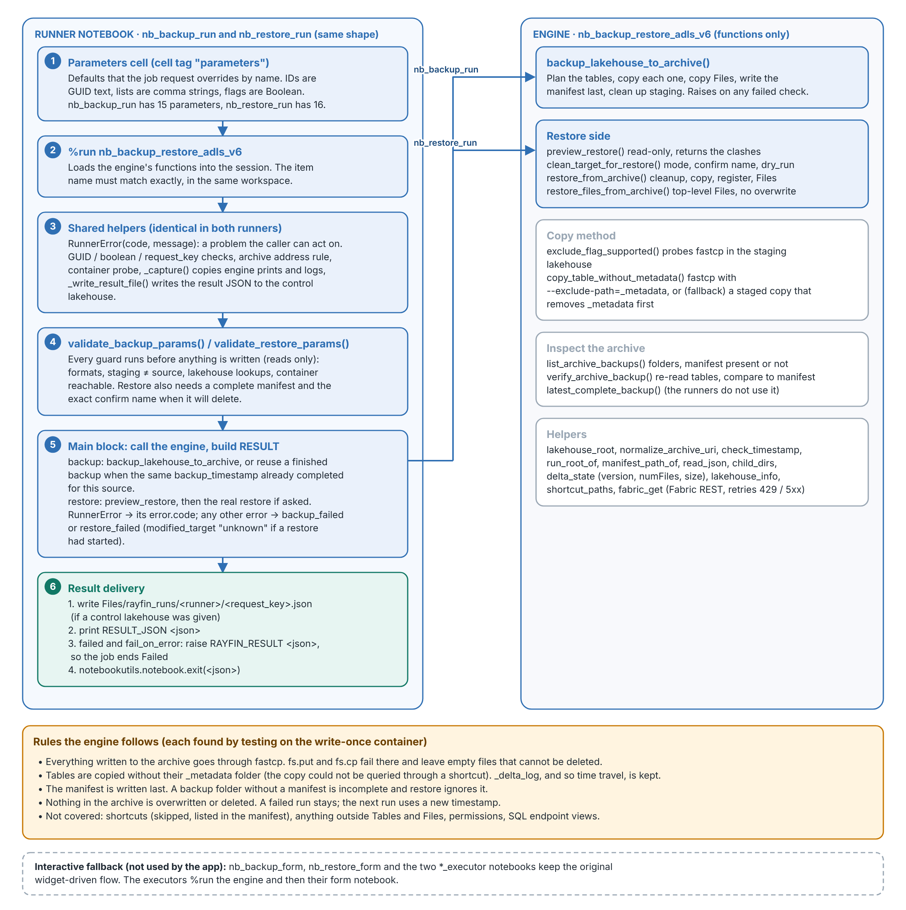
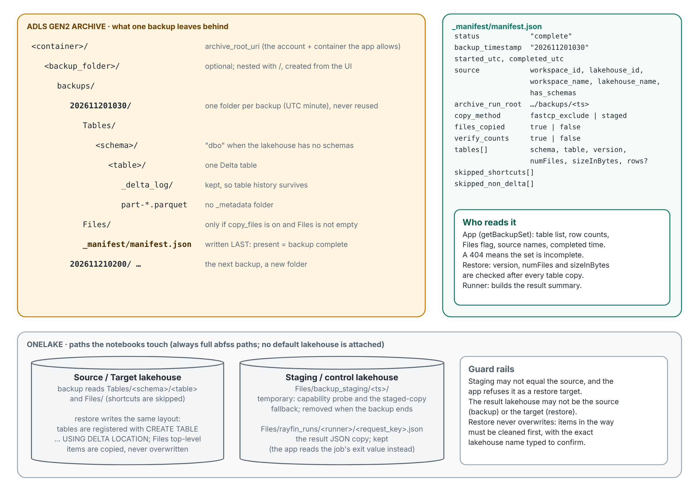

# Fabric backup / restore notebooks — headless runners for the Rayfin admin app

| File | What it is |
|---|---|
| `nb_backup_restore_adls_v6.ipynb` | **Engine.** Code cells are byte-identical to the original (only outputs cleared; there were none). |
| `nb_backup_run.ipynb` | **Headless backup runner** (new). Parameters cell → `%run` engine → guards → backup → JSON. |
| `nb_restore_run.ipynb` | **Headless restore runner** (new). `mode` preview/restore → guards → preview / restore → JSON. |
| `nb_backup_form.ipynb`, `nb_restore_form.ipynb`, `nb_backup_executor.ipynb`, `nb_restore_executor.ipynb` | **Interactive fallback**, unchanged code. Outputs cleared, execution counts null, saved widget state removed (it held typed workspace / lakehouse / storage names). |
| `tests/` | Stub test used to check the runners (see "What was tested"). Not needed in Fabric. |

## How it works





How the app drives these notebooks: [architecture](../docs/diagrams/01-architecture.png),
[a backup](../docs/diagrams/02-backup-flow.png), [a restore](../docs/diagrams/03-restore-flow.png)
(all in [`docs/diagrams`](../docs/diagrams), SVG alongside).

## Import — workspace and order

1. Create / pick **one** Fabric workspace on a Fabric capacity (trial or F SKU; the notebooks use Spark). Import **all** the notebooks into that **same** workspace.
2. Import `nb_backup_restore_adls_v6` first, then the two runners, then (optionally) the four interactive notebooks. Import order does not matter technically, but the **item names must stay exactly as the file names**: the runners do `%run nb_backup_restore_adls_v6` and the executors do `%run nb_backup_form` / `%run nb_restore_form`.
3. **Why the same workspace:** the Fabric docs for `%run` say it "currently only supports reference notebooks in the same workspace with the current notebook", and that without `-b` it "attempts to find and execute notebook item inside the same workspace" ([Develop, execute, and manage notebooks → Reference run](https://learn.microsoft.com/en-us/fabric/data-engineering/author-execute-notebook)). Cross-workspace reuse exists only for `notebookutils.notebook.run(..., workspace_id)` (runtime 1.2+), which runs the child as a separate notebook and does not share variables, so it is not a drop-in for `%run`.
4. Do **not** attach a default lakehouse to any of these notebooks. Everything uses full OneLake / ADLS paths. (The notebookutils docs also block a child run if it declares a different default lakehouse from its parent.)
5. Keep the item names exactly as above. The app lists the notebook workspace and resolves `nb_backup_run` and `nb_restore_run` by display name, so you do not copy item ids into the app. `npm run setup:notebooks` imports these three files for you.

## Identity and permissions

An API-triggered notebook run executes as **the identity that calls the job API** (for the Rayfin app that is the app identity, not the signed-in admin). That identity needs:

- **Run permission on the runner notebooks**, i.e. the scope `Notebook.Execute.All` (or `Item.Execute.All`) and a role on the runner workspace that lets it execute them (Contributor is the safe choice).
- **Source workspace/lakehouse** (backup): read of the lakehouse tables and Files, and permission to read its shortcut list.
- **Staging lakehouse** (backup): write (the engine creates `Files/backup_staging/<ts>` and removes it).
- **Target lakehouse** (restore): write and delete (tables, Files, `CREATE SCHEMA`, `CREATE TABLE ... LOCATION`).
- **Storage RBAC on the container** (ADLS Gen2, write-once): `Storage Blob Data Contributor` for backup (writes through `fastcp`), at least `Storage Blob Data Reader` for restore/preview. The runners also fail early with `container_unreachable` if the container root cannot be listed.
- Optional **control lakehouse** (see `result_*` below): write.
- Fabric REST reads used by the engine: workspace, lakehouse and shortcut lookups.

Unverified: the *minimum* Fabric roles for the data reads above (Contributor on the three workspaces certainly works for the notebook user today; narrower roles were not tested), and whether storage pass-through from a notebook works when the caller is a service principal / managed identity rather than a user. **Test this first with the real app identity** before building on it.

## How results come back (important)

- The runners finish with `notebookutils.notebook.exit(<JSON string>)` and also print `RESULT_JSON <json>`.
- **The public Get Item Job Instance response has no output field** (documented fields: `id, itemId, jobType, invokeType, status, rootActivityId, startTimeUtc, endTimeUtc, failureReason`), so the exit value is *not* available to a caller that only uses the Run On Demand + Get Item Job Instance APIs (it is available when the runner is called from a pipeline Notebook activity or `notebookutils.notebook.run`). So:
  1. **Failure:** with `fail_on_error = true` (default) a failed run ends with an exception whose text is `RAYFIN_RESULT <json>`, so the job status is `Failed` and `failureReason` should carry it. *Whether `failureReason` includes the full exception text was not verified.*
  2. **Success / details:** pass `result_workspace_id` + `result_lakehouse_id` (a small "control" lakehouse) and the runner also writes the same JSON to `Files/rayfin_runs/<runner>/<request_key>.json` (OneLake). The app reads it with its Fabric/OneLake token. Without these, only the job status plus the monitoring page output carry the result.
  3. Backups are also self-describing: `<archive>/backups/<ts>/_manifest/manifest.json` has the table list, row counts, skipped shortcuts.
- Job status values to poll: see Get Item Job Instance (`NotStarted`, `InProgress`, `Completed`, `Failed`, `Cancelled`, `Deduped`). `Completed` + `fail_on_error=true` means the runner returned normally; read the result file for `status`.

## Parameters and types

Job API request: `POST https://api.fabric.microsoft.com/v1/workspaces/{workspaceId}/notebooks/{notebookId}/jobs/execute/instances?beta=false`, body `{"parameters":[{"name","value","type"}], "executionData":{...}}`. Valid `type` values (ItemJobParameterType): **`Text`, `Boolean`, `Integer`, `Number`, `VariableReference`**; `value` is typed JSON (strings quoted, booleans unquoted). Parameter **names are case-insensitive in the API but must match the code cell's casing**; the names below are the code names. Only the parameters you send are overridden; the rest keep their defaults ([Run On Demand Notebook](https://learn.microsoft.com/en-us/rest/api/fabric/notebook/background-jobs/run-on-demand-notebook)). Fabric marks the parameter cell with cell metadata `"tags": ["parameters"]` in the `.ipynb` (UI: *Toggle parameter cell*); the engine adds a cell right below it that overrides the defaults ([Learn: Designate a parameters cell](https://learn.microsoft.com/en-us/fabric/data-engineering/author-execute-notebook); the tag form appears in Microsoft's own [fabric-toolbox notebooks](https://github.com/microsoft/fabric-toolbox/blob/9dcbc144/tools/FabricLoadTestTool/RunPerfScenario.ipynb)). Complex types (list/dict) are not supported: schema/table lists are comma strings.

The runners also accept the strings `"true"`/`"false"` for Boolean parameters in case a caller sends `Text`, but send `Boolean`.

### `nb_backup_run`

| Parameter | Type | Default | Notes |
|---|---|---|---|
| `source_workspace_id` | Text (GUID) | `""` | required |
| `source_lakehouse_id` | Text (GUID) | `""` | required |
| `staging_workspace_id` | Text (GUID) | `""` | required; (workspace, lakehouse) must differ from source |
| `staging_lakehouse_id` | Text (GUID) | `""` | required |
| `archive_root_uri` | Text | `""` | `abfss://<container>@<account>.dfs.core.windows.net`; required |
| `backup_folder` | Text | `""` | folder inside the container (letters, digits `._-`, `/` for nesting); `""` = root |
| `copy_files` | Boolean | `true` | form default |
| `verify_counts` | Boolean | `true` | form default |
| `only_schemas` | Text | `""` | optional comma list; engine feature the form did not expose |
| `only_tables` | Text | `""` | optional comma list |
| `backup_timestamp` | Text | `""` | optional 12 digits `YYYYMMDDHHMM` (UTC). Blank = now. **Set it for idempotent retries** (below) |
| `request_key` | Text | `""` | `[A-Za-z0-9._:-]{1,128}`; blank → `manual-xxxxxxxx` |
| `result_workspace_id` / `result_lakehouse_id` | Text (GUID) | `""` | optional control lakehouse for the result file; must not be the source |
| `fail_on_error` | Boolean | `true` | |

Guards (all blocking, before anything is written): GUID format, staging ≠ source, source and staging lakehouses resolvable by the runner, archive address format, folder format, container root listable, timestamp format, booleans.

**Idempotency:** the engine refuses to reuse a run folder, and the default timestamp has one-minute resolution. If the app generates `backup_timestamp` itself and retries a job with the same value, the runner returns `succeeded` with `already_existed: true` when a complete manifest for **this source lakehouse** exists at that timestamp (it does not run the backup again); a manifest for a different source or an incomplete folder gives `timestamp_conflict`. De-duplicating *job submissions* (so a double click does not start two jobs) still has to be done by the app using `request_key`; the notebook cannot see other running jobs.

### `nb_restore_run`

| Parameter | Type | Default | Notes |
|---|---|---|---|
| `mode` | Text | `"preview"` | `"preview"` or `"restore"` |
| `archive_root_uri` | Text | `""` | as above |
| `backup_folder` | Text | `""` | folder that holds `backups/` |
| `backup_timestamp` | Text | `""` | **required**, 12 digits, must be a complete backup (blank = "latest" is not supported on purpose) |
| `target_workspace_id` | Text (GUID) | `""` | required |
| `target_lakehouse_id` | Text (GUID) | `""` | required |
| `restore_files` | Boolean | `true` | form default |
| `only_schemas` | Text | `""` | comma list; blank = all |
| `only_tables` | Text | `""` | comma list; blank = all |
| `clean_target` | Text | `""` | `""` (stop if anything is in the way) / `"replace"` / `"all"` |
| `confirm_target_name` | Text | `""` | for `replace`/`all` in `mode="restore"`: must equal the **resolved** target lakehouse name exactly (case-sensitive) |
| `dry_run` | Boolean | `true` | only for `mode="restore"`: `true` = every check, change nothing. A real restore needs `mode="restore"` **and** `dry_run=false` |
| `request_key` | Text | `""` | as above |
| `result_workspace_id` / `result_lakehouse_id` | Text (GUID) | `""` | optional control lakehouse; must not be the target |
| `fail_on_error` | Boolean | `true` | |

Guards: backup complete (manifest exists and says `complete`), `clean_target` value, `all` + schema/table filters rejected (preview too), exact confirm name (restore mode), container readable, target resolvable, target-not-empty without `clean_target` refused up front (`target_not_empty`, nothing touched; the engine would refuse too). Preview never modifies anything: it calls `preview_restore` and, only if cleanup was asked for **and** the confirm name matches, `clean_target_for_restore(dry_run=True)`.

## Exit JSON

Common to both (`schema_version` = 1): `runner`, `request_key`, `status`, `error` (`null` or `{code,message}`), `started_utc`, `finished_utc`, `duration_seconds`, `report` (last lines the engine printed), `log_tail` (failures only; engine log lines), `result_file` (path, if written). Lists are cut at 200 items with a `*_count` field next to them.

`status` values: backup `succeeded | failed`; restore `succeeded | completed_with_problems | failed`.
`error.code`: `invalid_parameter, staging_is_source, lakehouse_not_found, container_unreachable, timestamp_conflict, backup_failed` (backup); `invalid_parameter, container_unreachable, backup_incomplete, lakehouse_not_found, confirmation_mismatch, target_not_empty, cleanup_blocked, restore_failed` (restore).

**Backup success**
```json
{"schema_version":1,"runner":"nb_backup_run","request_key":"req-123","status":"succeeded","error":null,
 "started_utc":"…","finished_utc":"…","duration_seconds":412.3,
 "source":{"workspace_id":"…","lakehouse_id":"…","workspace_name":"…","lakehouse_name":"…"},
 "archive":"abfss://<container>@<account>.dfs.core.windows.net/<folder>",
 "already_existed":false,"backup_timestamp":"202611201030",
 "backup_location":"<archive>/backups/202611201030",
 "tables_backed_up":42,"schemas":["dbo"],"rows_total":1234567,"files_included":true,"verify_counts":true,
 "copy_method":"fastcp_exclude","skipped_shortcuts":["Tables/dbo/x"],"skipped_shortcuts_count":1,
 "skipped_non_delta":[],"skipped_non_delta_count":0,"manifest_completed_utc":"…","report":["BACKUP COMPLETE: …"]}
```
**Restore preview** (also `mode:"restore"` with `dry_run:true`):
```json
{"schema_version":1,"runner":"nb_restore_run","request_key":"rq-1","status":"succeeded","error":null,
 "mode":"preview","dry_run":null,"modified_target":false,"backup_timestamp":"202611201030","archive":"…",
 "target":{"workspace_id":"…","lakehouse_id":"…","workspace_name":"…","lakehouse_name":"…","has_schemas":true},
 "backup":{"source_workspace_name":"…","source_lakehouse_name":"…","completed_utc":"…","tables_in_backup":42,"files_in_backup":true},
 "restore_files":true,"clean_target":"replace","only_schemas":[],"only_tables":[],"confirm_matches":true,
 "tables_to_restore":42,"unmatched_schemas":[],"unmatched_tables":[],
 "clashes":[{"path":"Tables/dbo/orders","kind":"table"}],"clashes_count":1,
 "outcome":"will_delete_then_restore",
 "cleanup_plan":[{"path":"Tables/dbo/orders","action":"would delete"}],"cleanup_plan_error":null,
 "report":["Backup : …","RESULT : …"]}
```
`outcome` ∈ `nothing_in_the_way | will_stop_target_not_empty | will_delete_then_restore | will_delete_everything_then_restore`. `cleanup_plan` is `null` unless cleanup was requested and confirmed; `cleanup_plan_error` carries engine refusals (e.g. a shortcut sits where the backup restores).

**Restore result** (`mode:"restore"`, `dry_run:false`): the preview fields above (taken just before the restore) plus
```json
{"modified_target":true,"status":"succeeded",
 "tables":[{"schema":"dbo","table":"orders","version":7,"outcome":"restored","status":"restored","location":"abfss://…"},
           {"schema":"dbo","table":"x","version":3,"outcome":"copied_registration_failed","status":"copied, registration failed: …","location":"abfss://…"}],
 "tables_count":42,"tables_restored":41,"tables_registration_failed":1,"files_restored":true}
```
`status` is `completed_with_problems` when any table is `copied_registration_failed` (data is in place; registration needs a manual `CREATE TABLE … LOCATION`). On `failed`, `modified_target` is `false` if the failure was a check, or `"unknown"` if the engine stopped part-way (the engine does not return partial results; `log_tail` shows how far it got).

## Sample job requests

Backup:
```http
POST https://api.fabric.microsoft.com/v1/workspaces/<RUNNER_WORKSPACE_ID>/notebooks/<NB_BACKUP_RUN_ID>/jobs/execute/instances?beta=false
{
  "parameters": [
    {"name": "source_workspace_id",  "value": "<GUID>", "type": "Text"},
    {"name": "source_lakehouse_id",  "value": "<GUID>", "type": "Text"},
    {"name": "staging_workspace_id", "value": "<GUID>", "type": "Text"},
    {"name": "staging_lakehouse_id", "value": "<GUID>", "type": "Text"},
    {"name": "archive_root_uri",     "value": "abfss://<container>@<account>.dfs.core.windows.net", "type": "Text"},
    {"name": "backup_folder",        "value": "<folder>", "type": "Text"},
    {"name": "copy_files",           "value": true,  "type": "Boolean"},
    {"name": "verify_counts",        "value": true,  "type": "Boolean"},
    {"name": "backup_timestamp",     "value": "202611201030", "type": "Text"},
    {"name": "request_key",          "value": "bk-2026-11-20-<uuid>", "type": "Text"},
    {"name": "result_workspace_id",  "value": "<CONTROL_WS_GUID>", "type": "Text"},
    {"name": "result_lakehouse_id",  "value": "<CONTROL_LH_GUID>", "type": "Text"}
  ]
}
```
Restore preview, then the real restore (same body, `mode` and `dry_run` changed):
```http
POST https://api.fabric.microsoft.com/v1/workspaces/<RUNNER_WORKSPACE_ID>/notebooks/<NB_RESTORE_RUN_ID>/jobs/execute/instances?beta=false
{
  "parameters": [
    {"name": "mode",                "value": "restore", "type": "Text"},
    {"name": "dry_run",             "value": false,     "type": "Boolean"},
    {"name": "archive_root_uri",    "value": "abfss://<container>@<account>.dfs.core.windows.net", "type": "Text"},
    {"name": "backup_folder",       "value": "<folder>", "type": "Text"},
    {"name": "backup_timestamp",    "value": "202611201030", "type": "Text"},
    {"name": "target_workspace_id", "value": "<GUID>", "type": "Text"},
    {"name": "target_lakehouse_id", "value": "<GUID>", "type": "Text"},
    {"name": "restore_files",       "value": true, "type": "Boolean"},
    {"name": "only_schemas",        "value": "", "type": "Text"},
    {"name": "only_tables",         "value": "", "type": "Text"},
    {"name": "clean_target",        "value": "replace", "type": "Text"},
    {"name": "confirm_target_name", "value": "<exact target lakehouse name>", "type": "Text"},
    {"name": "request_key",         "value": "rs-2026-11-20-<uuid>", "type": "Text"},
    {"name": "result_workspace_id", "value": "<CONTROL_WS_GUID>", "type": "Text"},
    {"name": "result_lakehouse_id", "value": "<CONTROL_LH_GUID>", "type": "Text"}
  ]
}
```
Response: `202 Accepted` with `Location` (job instance URL) and `Retry-After`; poll `GET …/items/{notebookId}/jobs/instances/{jobInstanceId}` no sooner than `Retry-After`. Use a preview call (`mode` omitted) first and bind the restore to the same inputs.

## What was tested (and what was not)

- All 7 notebooks parse as valid nbformat 4.5 (`nbformat.validate`), all code cells compile (the `%run` cells excluded), outputs empty, `execution_count` null.
- `tests/test_runners.py`: executes the **real engine cells** and the runner cells with `notebookutils`, `spark`, `DeltaTable`, `requests` replaced by in-memory fakes (an in-memory OneLake/ADLS, fake Fabric REST). ~90 checks: backup success/guards/idempotency/failure/result file; restore preview, dry-run, real restore into an empty target, clash refusal, `replace` cleanup with exact confirm, confirm mismatch, `all` + filters, incomplete backup, unreachable container, registration failure, mid-restore failure, schema-less target. Preview and dry-run were asserted to change nothing (files, dirs, SQL).
- **Not tested:** anything in a real Fabric session (real `fastcp`, Delta, Spark SQL, write-once container behaviour, `%run` resolution, parameter injection types, the Job API itself, service-principal/app-identity execution, exit value / `failureReason` content, maximum exit-value size). The engine code is unchanged, so its proven behaviour is untouched; the new runner code has only run against fakes.
